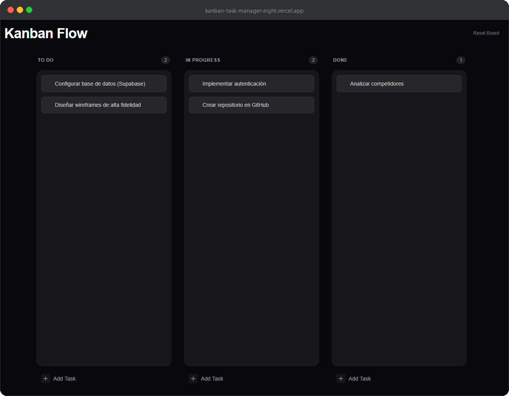

# Kanban Flow

A three-column kanban board with drag and drop, built with React and dnd-kit. The board
persists in `localStorage`, so a reload keeps your tasks without needing a backend.

**[Live demo](https://kanban-task-manager-eight.vercel.app)**



## What it does

- Drag tasks between Backlog, In Progress and Done — including into empty columns
- Create, rename and delete tasks directly on the board
- State is written to `localStorage` under the `kanban-tasks` key on every change
- "Reset board" restores the seed data from `src/data/board.js`

## Stack

React 19 · Vite · Tailwind CSS · @dnd-kit · uuid

## Run locally

```bash
npm install
npm run dev
```

## Structure

```
src/
├── components/
│   ├── Column.jsx             # Column shell and drop target
│   ├── SortableTask.jsx       # Sortable wrapper around each task
│   └── TaskCard.jsx
├── data/board.js              # Columns and seed tasks
└── App.jsx                    # Drag context, CRUD and persistence
```

## Notes

There is no backend. Clearing the browser's site data resets the board to the seed tasks.
Task order within a column is part of the same array as the tasks themselves, so moving a
task also reorders it in the persisted list.
